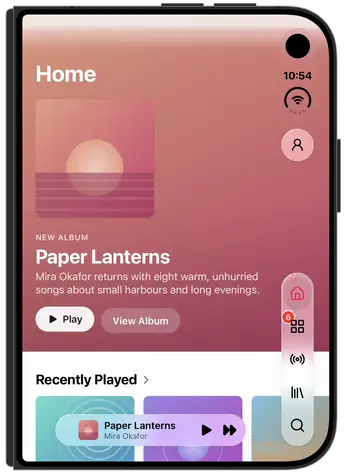
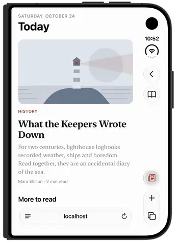
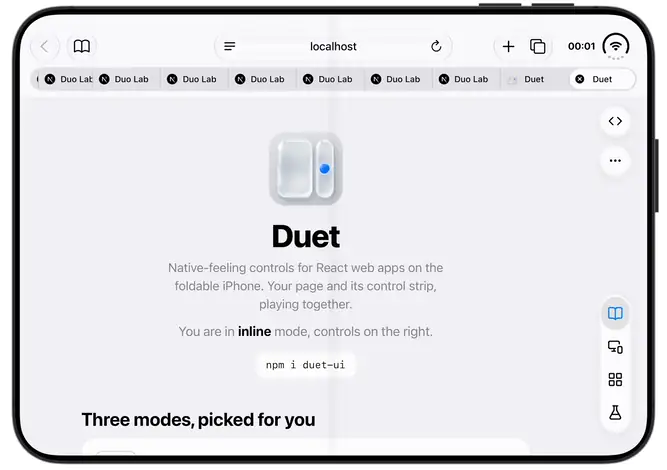

# Duet

Native-feeling controls for React web apps on the foldable iPhone (the "iPhone Duo"). Your page and its control strip, playing together.

```sh
npm i duet-ui
```

| Strip | Column | Inline |
| --- | --- | --- |
|  |  |  |

Recorded on the iPhone Duo simulator, framed by [`tools/media`](tools/media).

## What it does

On the closed Duo, iOS puts navigation in a vertical strip at the screen's edge, not a bottom tab bar. A Home Screen web app gets that strip as a safe-area inset. In a Safari tab, Safari owns the strip for its own buttons and leaves part of it empty. A web page that ignores this ends up with its own bar fighting Safari's, or its buttons under the camera.

`<Duet>` draws your menu (a burger opening a sidebar), actions and primary action where a native app would, picks one of three layouts (`strip`, `column`, `inline`) from the window geometry, keeps every control inside the space it may use, and folds what does not fit into a "…" menu. `<DuetPanes>` shows one screen of a path when the page is narrow and two side by side when it is wide. `useDuet()` tells your own code what Duet decided, including whether this looks like an iPhone Duo.

Everything is inferred from web signals (window and screen sizes, safe-area insets, display mode, user agent). iOS gives a web page no API for the device model, the fold, Safari's buttons or the Dynamic Island, so detection is a heuristic built from measurements, and column mode relies on WebKit behaviour that is not a supported API. See [Limitations](#limitations).

## Requirements

- React and React DOM 18.3 or newer (peer dependencies).
- A bundler that handles CSS imported from a package (Next.js, Vite): the components import their own stylesheet. It is also exported as `duet-ui/styles.css`.
- Duet's components and hooks are client components (`"use client"` in the Next.js App Router).
- The type definitions use `NoInfer`, so TypeScript 5.4 or newer.

## Quick start

```tsx
"use client";
import { useState } from "react";
import { House, Link, Plus, Search } from "lucide-react";
import { Duet, column, type DuetMenuItem } from "duet-ui";

const PLACES = [
  { id: "home", label: "Home", icon: <House size={22} /> },
  { id: "search", label: "Search", icon: <Search size={22} /> },
] as const satisfies readonly DuetMenuItem[];

type Place = (typeof PLACES)[number]["id"];

export function App() {
  const [place, setPlace] = useState<Place>("home");
  return (
    <Duet
      menu={{ items: PLACES, selected: place, onSelect: setPlace }}
      actions={[{ id: "copy", label: "Copy link", icon: <Link size={22} />, onPress: () => navigator.clipboard.writeText(location.href) }]}
      primary={{ id: "new", label: "New note", icon: <Plus size={22} />, onPress: create }}
    >
      <main style={column(680)}>
        <h1>{place === "home" ? "Home" : "Search"}</h1>
      </main>
    </Duet>
  );
}
```

Icons are yours, from any library (this example uses `lucide-react`): 21 to 22pt on round buttons match the system. `as const` types the menu ids, so `onSelect` takes `setPlace` without a cast. Each place keeps its own scroll position. Pass the page as `children`: it then scrolls in an inner scroller, which keeps the controls still during momentum scroll and lets the burger slide it aside. Without `children` the document scrolls and the controls follow it (see [Column mode](#column-mode-how-it-works)).

On phones and browsers that are not an iPhone Duo in Safari or a Home Screen app, the same code renders the `inline` layout, so you may want to render `<Duet>` only where `useDuet().duo` is true (see [Server rendering](#server-rendering-and-hydration)).

## How Duet decides

### Is this an iPhone Duo?

`useDuet().duo` (and `isDuo(signals)`) is a heuristic. It is true when both hold:

1. The screen size (`screen.width` x `screen.height`) or the window size (`outerWidth` x `outerHeight`) matches, within 1px and in either orientation, one of the sizes measured on the Duo: 466x678 (closed screen; Safari keeps reporting it as `screen.*` after unfolding), 669x951 (open screen) or 469x669 (a Safari split-view pane).
2. The user agent says iOS: it contains `iPhone` or `iPod`, or it contains `Macintosh` and `navigator.maxTouchPoints` is greater than 1 (Safari's "Request Desktop Website"). Signals without a user agent, such as ones you build yourself for `isDuo()`, skip this check.

Possible false positives: an iPad (which also sends a Mac user agent with touch) or another iOS device whose screen or window happens to match one of these sizes. Possible false negatives: anything that changes the reported sizes, such as a different display zoom setting, a future iOS release, or a window size that was not measured. Use it to switch to a Duo layout, not as proof of the device.

### Which mode

Duet re-reads the signals on resize, orientation change (including `screen.orientation` change: turning from one landscape to the other keeps the window size), visual viewport resize, `pageshow` and `visibilitychange` (so a page handed from the in-app preview to a Safari tab re-reads). The window size and insets settle late (after a fold `outerWidth` can land up to ~2s after the viewport, with no event), so after each event Duet polls every 100ms until the sizes hold for 500ms, re-reading on every change, for at most 2s. It picks the first mode that matches:

| Order | Mode | Conditions (all must hold) | Controls |
| --- | --- | --- | --- |
| 1 | `strip` | Running as a Home Screen app (`navigator.standalone` or `display-mode: standalone`) on a Duo (`duo` true), and the left or right safe-area inset is at least 76px (the Duo's strip is 84; an iPhone's landscape sensor inset is 59, an Android cutout 62). The right side wins if both are. Also the in-app Safari preview turned sideways in its default or full style (below): closed screen, 678x466 window, an 84px safe-area inset on the turned side. | In the strip iOS gives the app, beside the page (in the preview, in the inset below its top bar) |
| 2 | `column` | Not a Home Screen app; not inside an iframe; not the in-app Safari preview turned sideways (below); the browser is Safari (below); `outerWidth - innerWidth` is 80 to 88px; `outerHeight - innerHeight` is 68 to 102px (not checked in the in-app preview, whose top bar compacts on scroll); portrait (`innerHeight > innerWidth`), or landscape in a window the size of the closed screen (678x466 within 1px) with `screen.orientation.angle` 90 or 270; the page is not zoomed (`visualViewport.scale` 1); the oscillation guard has not paused column mode; and either the window is a split-view pane (`outerWidth` x `outerHeight` 469x669 within 1px, iOS user agent) or `duo` is true | Painted into the part of Safari's column (or the in-app preview's) its own buttons leave empty, so the page keeps its full width |
| 3 | `inline` | Everything else: unfolded at full width, landscape of unknown turn, other browsers, in-app web views, the in-app Safari preview unfolded, other phones, desktops | An 84px strip inside the page, on the side the user picks |

"Safari" means the user agent has `Version/x Safari/` and none of the tokens of other iOS browsers and apps (`CriOS`, `FxiOS`, `EdgiOS`, `OPiOS`, `GSA/`, `Ddg/`); an in-app web view drops the `Safari/` token. `useDuet().browser` reports the result: `"safari"`, `"chrome"`, `"firefox"`, `"edge"`, `"webview"` or `"other"`. Other browsers draw their own chrome where Safari has its column, so they always get `inline`.

There is no fold signal. The mode follows the geometry: folding or unfolding changes the window size, and the mode follows on the next read.

How a new reading is committed:

- **Keyboard.** The keyboard does not change the mode. `useDuet().keyboard` is true while the visual viewport is shorter than the page, and `<Duet>` sets `data-keyboard`; in `column` and `inline` mode the controls hide until it closes (it covers the lower column, and the inline rail would slide off). It counts only while a text field has focus, and until the viewport grows back once focus leaves.
- **Zoom.** While the page is zoomed (`visualViewport.scale` not 1, for example Safari zooming out when an input takes focus) the window signature is unreadable, so Duet keeps the last context.
- **Drift.** While the window is still settling, a mode change at the same window size, page width and turn is held until the sizes stop moving; a change of window size, page width or turn commits at once.
- **Loops.** A mode that flips twice in 2s at a stable window is pinned for 3s, doubling on each repeat up to 60s.
- `useDuet().confidence` says how the context was reached: `"sure"` (settled signals), `"settling"` (the window is still moving) `"held"` (the last context, kept through zoom or drift) or `"moving"` (a turn or fold caught halfway, controls hidden).

### Column mode: how it works

Column mode infers from the window geometry that Safari's column is there; it never sees Safari's buttons. The 80 to 88px width difference is Safari's column (84px measured), the height difference is Safari's chrome below the page.

- `position: fixed` content stops at the page viewport (and a fixed box covering the middle of the viewport edge has its colour painted over the column, see [Modals and sheets in column mode](#modals-and-sheets-in-column-mode)), but WebKit paints in-document content that overflows the layout viewport into Safari's column. Duet renders the controls in an absolute layer at the top of the document, widens the document by the column's width, keeps the document itself from scrolling (the page scrolls in the inner scroller) and sets `touch-action: pan-y` on `<html>` so the page does not pan sideways. This is observed WebKit behaviour, not a supported API.
- Without `children` the document itself scrolls, and the layer follows it on a CSS scroll timeline (`animation-timeline: scroll(root)`). Safari runs the timeline with the scroll, so the controls hold through momentum and through smooth programmatic scrolls (`scrollIntoView({ behavior: "smooth" })`, `scrollTo({ behavior: "smooth" })`): you need no scroll listener and no `behavior: "auto"` workaround. Measured on the simulator: within 1px through flings and at rest, and one frame of up to 7pt at the end of a smooth scroll (a transform set on scroll ran up to 300pt off there). The keyframe ends at `scrollHeight - innerHeight`, Safari's own timeline range, which follows its URL bar as it collapses. Without scroll-timeline support, or when a page reset like `* { animation: none !important }` removes it, Duet falls back to a transform set on scroll, which lags in momentum. Children mode stays the steadier choice.
- The widened document can pan sideways when a swipe runs off the end of a horizontal scroller (a chip row), since `touch-action` stops at that scroller. Duet pins `scrollX` (0, or the column width when the document spans a left column) on every scroll and sets `overscroll-behavior-x: contain` on all elements at zero specificity (`:where()`), so your own value wins.
- Touches in the column reach the page but are not hit-tested to Duet's buttons, and Safari usually keeps the touch end. Duet listens for `pointerdown`, finds the button under the touch's coordinates and clicks it, so a column button fires on touch down.
- Placement comes from constants measured on the iPhone Duo simulator (iOS 27.1) and checked on a device: Safari's back and reader rows at the top of the column, its +/tabs pill at the bottom. A Safari update that moves its buttons or changes this painting behaviour needs new measurements.

### Modals and sheets in column mode

A modal or sheet on the web usually sits on a full-screen scrim: `position: fixed; inset: 0`. In Safari's column on the closed Duo that used to hide Duet's whole column layer, the close button included (#79).

- **What you see:** nothing to handle. While the overlay is open, the controls stay in the column and keep working. Safari's own buttons there are unaffected either way.
- **Cause:** Safari 26 hit-tests the middle of each viewport edge, 4px in, for a fixed or sticky box (WebKit's `LocalFrameView::fixedContainerEdges`). When one covers that point, Safari paints the box's colour, or plain chrome when the box has a `backdrop-filter`, over everything beyond that edge, Safari's column included. Duet's column layer is in-document content, so it disappears under that fill. Measured on the simulator: a scrim 3px short of the edge still hides the column, 6px short does not, and a scrim of 90% width or 40% height does not.
- **What Duet does:** on a Duo in Safari it renders a small fixed guard (`.duet-guard`, 16x64px, transparent, `pointer-events: none`, top `z-index`) straddling that point on each viewport edge, in every mode, so it is there through folds and turns too. Safari's hit test lands on the guard, which is too small to count as a container, so it finds none and keeps painting the column normally. The guard takes no taps and paints nothing.
- **What you must do:** nothing for visibility. For a native feel, pass `close` to `<Duet>` while the sheet is open, so the controls hold only its close button, and hide the sheet's own X while Duet shows its close (`<html data-duet-close>`, set in every mode, so the open screen shows one X too):

  ```tsx
  <Duet menu={menu} close={open ? { label: "Close", onPress: () => setOpen(false) } : undefined}>
  ```

  ```css
  html[data-duet-close] .sheet-x { display: none; }
  ```

  The old workaround, making the scrim `position: absolute` in column mode, still works and is no longer needed.
- **Blur:** keep `backdrop-filter` off the scrim box itself and put it on a `::before`, so Safari's bar takes the dimmed colour on the open screen instead of a solid band (see [Sheet scrim stops at Safari's bar](#sheet-scrim-stops-at-safaris-bar)):

  ```css
  .sheet-scrim { position: fixed; inset: 0; background: rgb(0 0 0 / 0.38); }
  .sheet-scrim::before { content: ""; position: absolute; inset: 0; z-index: -1; pointer-events: none; backdrop-filter: blur(8px); }
  ```
- **Not covered:** `<dialog>.showModal()` puts its `::backdrop` in the browser's top layer, above any `z-index`, so it still hides the column (checked on the simulator), and the page outside a modal dialog is inert anyway, so Duet's buttons could not take taps. Use a fixed `<div>` scrim (or `dialog.show()` with your own scrim) when you want the column controls. A page box of your own with `z-index: 2147483647` over the middle of the column edge also beats the guard.

Try it on the [site](https://getduet.dev/sheet).

### Split view

A Safari split-view pane (469x669 window, 385x571 page) has Safari's column on the pane's outer edge, but no web signal says whether the pane is on the left or the right. In column mode Duet widens the document by a column on each side and draws the controls in both; each pane only shows its own column, and a tap there tells Duet which side it was. The document is kept scrolled across the left column, so a pane shows document x 84 to 469. When a split pane falls back to `inline`, its side is remembered separately from the full-window side, so the user can move the controls next to Safari's column once. `useDuet().split` is true in a split pane.

### Side

`useDuet().side` is the edge the controls are on. It is only detected in `strip` mode (from which safe-area inset is large). In `column` mode it is Safari's column on the closed Duo: `"right"` in portrait; turned sideways, the side the camera is on, `"left"` at angle 90 (turned anticlockwise) and `"right"` at 270. A left column widens the document on the left and keeps it scrolled across, as in split view. In a split pane it is nominal, since both edges are drawn. In `inline` mode it is the user's choice: drag the controls across the middle of the page, or use "Move controls" in "…". The choice is stored in `localStorage` per site (`duet-side`, or `duet-side-split` in split view). Without one, it is `"right"`. In the in-app preview turned sideways (`strip`) it is the side of the safe-area inset: `"left"` at angle 90, `"right"` at 270.

### In-app preview

Links opened from social and mail apps can open in the in-app Safari preview (`SFSafariViewController`). On the closed Duo the preview has a column like a Safari tab's, holding its own buttons: close and reader/menu at the top, back and a share/reload/Safari pill below. In portrait Duet uses `column` and puts its controls into the free gap between the reader/menu button and the back button (146pt, screen y 282 to 428, the same in the sheet and full screen on the simulator and a real Duo), so the page keeps its full width. Live Activities push close and reader/menu down (one about 45pt on a real Duo) while back stays put, and a page can't tell, so Duet assumes the worst case (`DUO.island`, two activities, as in a Safari tab): the gap is then about 54pt, room for one button, and none of Duet's buttons can ever sit under the preview's. That button is "…", centred in the gap, its list holding the places under "Menu", then the page's actions. Turned sideways, the preview's layout depends on its style. The sheet keeps a column on the side the Duo is turned to, with a gap of about 26pt, too small for a button: there Duet hides its controls (`useDuet().hidden` is `"preview"`, the controls get `visibility: hidden` and no inset) instead of drawing an inline strip across the page, so the page keeps its full width and the preview's own close, back, share and "Open in Safari" stay usable. The default and full styles move every native button into a top bar (window y 24 to 68) and give the page an 84px safe-area inset on the turned side (left at 90, right at 270) that nothing draws in: Duet uses `strip` there, its controls in that inset from below the top bar to above the home indicator, and the page keeps its width. Turning back to portrait, or opening the page in Safari, brings the column back. A strip across page content was flagged in review and is never used. Duet sets `useDuet().preview` in both. Duet takes a Safari window that is not standalone to be the preview when it is either:

- the closed screen's 466x678 window with the column signature, 44 to 77px of chrome (the preview has 75, down to 46 as its top bar compacts on scroll in the default and full styles; a Safari tab 98, or 80 with the compact URL bar) and a bottom safe-area inset (34 in the preview, 0 in a tab), or
- a page sheet: a window inside the closed 466x678 screen, in either orientation (450x670 on a real Duo, 662x458 turned) with the column signature and a bottom safe-area inset, or
- exactly 375x667 at `devicePixelRatio` 3, the size earlier builds gave the preview.

No Safari tab on the Duo is smaller than the screen (a split pane is 469 wide, the screen 466), and iOS has no windowed Safari or Stage Manager, so a window inside the screen is the sheet.

The verdict is sticky: a page that loaded as a tab stays a tab while its page height and insets move (scrolling collapses the URL bar to 80px of chrome), and is only re-decided when the window size, page width, turn, standalone or framing changes, or on `pageshow` or when the page becomes visible again. In a window's first second the verdict may still rise to preview, since the sheet's inset reads 0 on the first sample and 34 about 100ms later. A preview that stops matching becomes a tab at once.

While the Duo turns or folds, the window passes through sizes no landed window has (inner and outer orientations disagree, or the chrome around the page is not Safari's). Duet keeps the last placement and hides the controls (`hidden` is `"moving"`) until the window lands and holds there for 150ms, so nothing flashes at the wrong edge mid-turn, not even the closed portrait window an unfold from landscape passes through for a frame or two.

Unfolded, the preview is a sheet centred on the open screen (653x661 wide, 653x869 tall) with its bars above and below the page and no column: Duet reads it as the preview (`preview` true) and goes `inline` on the user's side, as in full width Safari. Limits: When "Open in Safari" hands the page to a tab, the `pageshow`/`visibilitychange` re-read switches to `column`. The [/probe page](https://getduet.dev/probe) logs every signal the rule reads, every 100ms. Measurements are in [docs/research-notes.md](docs/research-notes.md).

### Oscillation guard

Column mode can feed back into the signals (for example if Safari zooms the page out to fit the wider document, the column signature disappears, `inline` removes the overflow, and the signature returns). If the mode changes 3 times within 2 seconds while the outer window size stays the same, Duet pauses column mode for 3 seconds, then tries again. If the loop resumes as soon as the pause lifts, the next pause doubles. A change of window size resets the guard, and changes while the window is still settling after an event (the 2s polling above, as during a fold) are not counted: they are the transition, not a loop.

### Viewport meta

Duet appends `shrink-to-fit=no` to every `<meta name="viewport">` when `duet-ui` is imported, and `viewport-fit=cover` when `<Duet>` mounts, and keeps both on metas the framework adds or rewrites later. If there is no viewport meta it adds `width=device-width,initial-scale=1` first. It only appends a key that is absent: an existing `viewport-fit` or `shrink-to-fit` value is left as it is. Safe-area insets only reach the page with `viewport-fit=cover`, so with `viewport-fit=contain` `strip` mode cannot be detected. Without `shrink-to-fit=no`, Safari zooms a split pane out to fit the widened document.

### Claimable space

Each mode has a band the controls may use, and Duet keeps every control inside it, so you never position anything yourself:

- **Above:** the status bar and Dynamic Island, and in Safari its own back and reader buttons at the top of the column. Live Activities grow the island down the strip and push Safari's buttons with it, and a page can't tell, so the band always assumes the worst case measured on device (two activities). That space stays empty even when none are running. A split-view pane on the right sits under the same status column, so it gets the same band as a closed tab, while the left pane uses the full column.
- **Below:** Safari's +/tabs pill, or the bottom edge.
- **Closed landscape:** Safari moves its back and reader rows and its pill on each side (left column: back slot top 81.5pt, pill top 327pt; right column: 23.5pt and 279pt), and Duet takes the gap between. Measured with a bare island; how Live Activities grow it sideways is not yet known.
- **What does not fit folds into "…"**: actions from the last, then `primary`. "…" shows whenever something is in it. Items marked `folded` or `destructive` always sit in "…", after the ones that did not fit.
- **Safari's column buttons are an exclusion zone for menus too.** Native chrome always paints over the page, so z-index can't help. A menu that reaches into the column keeps its top at or below `columnTop` (the reader button's worst-case bottom plus 11pt) and its bottom above Safari's pill, opening flush with the column like Safari's own menus. A menu too tall for that band opens wholly over the page, beside the column, where it may rise to the top of the page. One too tall even there caps its height and scrolls inside. Duet sets `--duet-safe-top-column` on `<html>` for your own popovers (0 outside `column` mode).

## Server rendering and hydration

The server can't measure anything, so on the server and during hydration `useDuet()` returns a fixed snapshot: `mode: "column"`, `duo: true`, `browser: "safari"`, `layout: "narrow"`, `side: "right"` (a closed Safari tab). The real values arrive right after hydration. So `useDuet().duo` is `true` in the server HTML on every device: a page that renders a Duo layout or a desktop layout from it switches once after hydration on non-Duo devices.

To choose the layout on the server, `<DuoCookie>` keeps a `duet-duo` cookie (`"1"` on a Duo) in step with the browser. Read the cookie on the server, render from it, and pass what you rendered as `rendered`. After hydration, if the browser's answer differs, `<DuoCookie>` updates the cookie and calls `onChange` (default: `location.reload()`), so a new device switches layout once. It renders nothing and works outside `<Duet>`. In the Next.js App Router:

```tsx
// app/page.tsx, a server component. DuoApp and DesktopApp are your own components.
import { cookies } from "next/headers";
import { DuoCookie } from "duet-ui";

export default async function Page() {
  const duo = (await cookies()).get("duet-duo")?.value === "1";
  return (
    <>
      <DuoCookie rendered={duo} />
      {duo ? <DuoApp /> : <DesktopApp />}
    </>
  );
}
```

Pass `onChange={() => router.refresh()}` from a client component to re-render without a reload.

### Pre-paint boot

`useDuet()` and `<Duet>` only know the mode once React mounts, so CSS keyed on `html[data-duet-mode="column"]` (a band bled into Safari's column, page controls moved there) would paint the plain layout first. Inline `bootScript` as the first child of `<body>`: it runs `detect()` before the first paint and, in column mode only, sets `data-duet-mode="column"`, `data-duet-boot` and `--duet-column`, `--duet-vh` and `--duet-inset-bottom` on `<html>`. Every other browser and device is left untouched. Once mounted, `<Duet>` takes the values over, or `useDuet()` removes them if the page is not in the column after all.

```tsx
// app/layout.tsx
import { bootScript } from "duet-ui/boot";

<html suppressHydrationWarning>
  <body>
    <script dangerouslySetInnerHTML={{ __html: bootScript }} />
    {children}
  </body>
</html>
```

`suppressHydrationWarning` on `<html>` because the script changes its attributes before React hydrates. `--duet-column` is the column's width (0px outside column mode once mounted).

## Props

### `<Duet>`

| Prop | Type | What it does |
| --- | --- | --- |
| `menu` | `{ items, selected, onSelect }` | The app's places (`DuetMenuItem[]`). The burger heads the controls and opens them in a sidebar, sliding the page aside. Each place keeps its scroll position |
| `actions` | `DuetItem[]` | Round buttons under the burger while they fit, the rest in "…". `destructive: true` items only show in "…", last, in red; `folded: true` items only in "…" |
| `primary` | `DuetPrimary` | The screen's main action, a tinted round button in its own group (at the thumb inline). The first tap arms it into a 214pt labelled pill, the second runs it, see [Call to action](#call-to-action). Folds into "…" when no arrangement keeps it |
| `close` | `false \| { label?, onPress }` | A sheet or card is open: the controls hold only a close button until it is cleared |
| `appearance` | `"auto" \| "light" \| "dark"` | Light or dark, like `overrideUserInterfaceStyle`. Default `"auto"`: follow the system. `dark` (boolean) still works but is deprecated |
| `tint` | `string` | Accent for the selected place, the primary button and checked menu rows, like iOS's `tintColor`. Default: system blue |
| `icons` | `{ size?, weight?, color? }` | How your icons are drawn. See [Theming](#theming) |
| `reserve` | `boolean` | Default `true`: the page keeps clear of the controls (`--duet-inset-*`, `<html>` margins). `false` lets it run under them |
| `children` | `ReactNode` | Page content, in an inner scroller so the document never scrolls and the controls stay still |

`DuetItem` is `{ id, label, icon, onPress?, badge?, badgeTone?, tint?, destructive?, folded? }`: `badge` is a number or short text in a badge, red by default; `badgeTone: "neutral"` makes it grey. `DuetMenuItem<T>` is `{ id: T, label, icon?, badge?, badgeTone? }`. `DuetPrimary` is a `DuetItem` plus `confirm?: string | false`: the armed pill's label (default `label`), or `false` to run on the first tap.

### The template

One template on every layout, the same in Safari's column, the strip, inline and split view: the burger first, then the actions while they fit, then "…", which closes the group, and the primary in its own group. Where the band shrinks, actions move into "…" one at a time, then the primary. The in-app preview's gap holds one button, so it shows only "…", whose list leads with a "Menu" section (the places), then "This page". "…" grows into its list on one interruptible spring, open and close; any tap outside closes it. The pure layout is exported (`template`, `allocate`, `frame`, `place`, `menuBox`, `pillRect`) for tests and custom chrome.

### Theming

Deliberately small, like iOS: an accent, an appearance and your icons. The glass itself stays native.

```tsx
<Duet appearance="auto" tint="#ff2d55" icons={{ size: 21, weight: 1.75 }} menu={...}>
```

- `tint` colours only what is active: the selected place, the checked menu item, the primary button. Everything else stays ink (black in light, white in dark).
- `appearance` sets the page theme. Menus follow it. In Safari's column the buttons keep following the system, so they match Safari's own; menus open over the page, so they keep `appearance`.
- `icons` sizes and weighs your icons, the way the system sizes SF Symbols in a native bar: `size` (round buttons, groups, menus, default 22px), `weight` (stroke width of SVG line icons such as Lucide, default 2) and `color` (unselected icons, default ink). SVGs are resized directly; font icons take the size as `font-size`, so give them `font-size: 1em` or leave it unset. The chrome's own glyphs (burger, close, "…") keep their native sizes.

Every prop writes a CSS custom property on `.duet`, so plain CSS can set the same tokens instead, globally or per appearance. These are stable:

| Token | What it is | Default |
| --- | --- | --- |
| `--duet-tint` | Accent: selected menu item, primary button | `#0088ff` |
| `--duet-ink` | Text and icon colour | black / white |
| `--duet-icon` | Unselected icon colour | `--duet-ink` |
| `--duet-icon-size` | Icons in round buttons, groups and menus | `22px` |
| `--duet-tab-icon-size` | Unused since 0.6 (no tab pill), kept so older CSS stays valid | `24px` |
| `--duet-icon-weight` | Stroke width of SVG line icons | `2` |
| `--duet-badge`, `--duet-badge-neutral`, `--duet-badge-ink` | Badge fills (alert, neutral) and text | red, grey, white |
| `--duet-solid` | Opaque surface: menus in Safari's column, the badge ring | near white / near black |
| `--duet-frost`, `--duet-menu` | Glass veil of controls and of menus | sampled from iOS |
| `--duet-sel`, `--duet-lift` | Selection and press highlight | sampled from iOS |

```css
:root .duet { --duet-tint: #ff2d55; --duet-icon-size: 21px; }
:root[data-lg-theme="dark"] .duet { --duet-tint: #ff6482; }
```

### Call to action

A page with one thing to do (book, buy, join) passes it as its primary, and folds what else it offers:

```tsx
<Duet
  actions={[
    { id: "share", label: "Share", icon: <Share />, onPress: share, folded: true },
    { id: "fav", label: "Favourite", icon: <Heart />, onPress: fav },
  ]}
  primary={{ id: "book", label: "Book", confirm: `Book · ${credits} credits`, icon: <CalendarCheck />, onPress: book }}
/>
```

- The first tap arms it: the round button grows toward the page into a 214pt tinted pill with icon and `confirm` (or `label`). The second tap runs `onPress`. A tap anywhere else disarms it. `confirm: false` runs on the first tap.
- `tint` on the primary overrides the accent for it alone. Change `label`, `icon`, `tint` or `folded` at any time, from state like any prop.

Between pages the controls move like a native bar: a group that appears scales up out of a blur, one that goes away shrinks into one and is kept for 450ms so it can, and the rest slide to their new places on the same spring. With reduced motion, controls crossfade in place.

### `useDuet()`

Returns the current `Context`: `mode`, `side`, `duo`, `browser`, `layout` (`"wide"` when `innerWidth` is at least 600px, else `"narrow"`), `split`, `preview` and `keyboard` (when true), `hidden` (`"moving"`, `"preview"` or `"pending"` when the controls are not drawn), `confidence`, `width` and `height` (the page viewport), `stableHeight` (the smallest page height seen at this window width and orientation, like CSS `svh`: it does not grow when Safari's URL bar collapses), plus the screen size and insets the placement uses. It works outside `<Duet>`.

### Lower-level exports

`isDuo`, `isIOS`, `isSplit`, `browserOf`, `detect`, `columnBand`, `magnet`, `panes`, `backFrom` and the measured constants (`DUO`, `INLINE_WIDTH`, `MAGNET`, `WIDE`) are exported for your own signals and tests, along with `isPreview`. The column template is exported too: `template`, `allocate`, `frame`, `place`, `menuBox`, `pillRect`, `groupHeight` and `TEMPLATE`. `duet-ui/geometry` exports the geometry module alone, without React.

`readSignals()` returns the current `Signals` from the window, the same reading the chrome uses (browser only). `watchSignals(cb)` calls `cb` whenever they may have changed, with the triggers and settle polling described in [Which mode](#which-mode), and returns the unsubscribe. Together with `detect` they let a page act on the mode before React mounts:

```ts
import { readSignals, watchSignals, detect } from "duet-ui";
const off = watchSignals(() => { document.documentElement.dataset.mode = detect(readSignals()).mode; });
```

## Laying out content

The page spans the whole window and the controls float over it, so backgrounds run on under them and the layout is asymmetric, like a native app. Only text and buttons keep clear.

- `column(maxWidth, pad)`: a centred reading column. It centres on the whole window and moves aside from the controls only as far as it must. The `duet-column` class does the same in CSS (`--duet-max`, `--duet-pad`).
- `bleed(pad)`: a full-width band (hero, sticky bar, list row). The band runs under the controls, its content is padded back beside them. `bleed(false)` runs content itself edge to edge (a map, an image). The `duet-bleed` class does the same in CSS.

Duet sets the insets on `<html>` as `--duet-inset-left`, `--duet-inset-right` (the controls' width on their edge; 0 in `column` mode without children, see below), `--duet-inset-top` (28px in `strip` mode, for iOS's top blur in Home Screen apps, else 0) and `--duet-inset-bottom` (in `column` mode, Safari's chrome below the page: the page runs on under Safari's floating URL bar, and the scroller ends with that much space so the last content scrolls clear) and `--duet-safe-top-column` (in `column` mode, the top of the part of Safari's column clear of its back and reader buttons: keep popovers that cross the column below it). `--duet-vh` is `stableHeight` in px: size full-screen sections with `min-height: var(--duet-vh, 100svh)` so they keep their height while the URL bar collapses and expands. Inside `<DuetPanes>` each pane gets its own left and right insets: only a pane on the controls' edge is inset. `<html data-duet-mode>` holds the current mode for CSS.

### Column mode without children: Duet places the page

In `column` mode the controls sit in Safari's column, outside the layout viewport, so a page has nothing to keep clear of. Without `children` Duet places the page itself, so any page, including one that never calls `column()` or `bleed()`, starts just clear of the controls, keeps centred content centred in the space left and is never clipped:

- The insets are 0 and the page's layout viewport is exactly the part of the window beside Safari's column.
- Where the document spans a left column (split view, the closed Duo turned to 90), Duet keeps it scrolled across and gives `<html>` `margin-left` of the column width and the matching negative `margin-right`, so the page lands in the visible part of the window instead of under the column. `<html data-duet-reserve>` marks this. Do not set `margin` on `<html>` yourself, and do not reset `scrollX`: Duet owns it.
- `<Duet reserve={false}>` opts out: the page runs under the column as before, and `--duet-inset-left` / `--duet-inset-right` hold the column's width for `column()`, `bleed()` or your own padding.

With `children`, in `inline` and `strip` mode and in the emulated column, the page still runs under the controls and keeps clear through the insets above.

## Panes

Apps with a path of screens (mailboxes, inbox, message) follow the fold with `<DuetPanes>`: when `layout` is `"narrow"` one pane shows, when it is `"wide"` the focused pane and the one before it show side by side. Going deeper slides the pair along the path instead of opening a modal. Every pane stays mounted (off-screen panes are inert), so drafts and scroll positions survive the fold.

```tsx
"use client";
import { Duet, DuetPaneBar, DuetPanes, usePanes } from "duet-ui";

const PATH = ["mailboxes", "inbox", "message"];

export function Mail() {
  const nav = usePanes(PATH);
  return (
    <Duet back={nav.back}>
      <DuetPanes path={PATH} at={nav.at} expanded={nav.expanded} panes={{
        mailboxes: <button onClick={() => nav.go("inbox")}>Inbox</button>,
        inbox: <button onClick={() => nav.go("message")}>First message</button>,
        message: (
          <article>
            <DuetPaneBar onClose={nav.close} onToggle={nav.toggle} expanded={nav.expanded} />
            <p>Hello from the message pane.</p>
          </article>
        ),
      }} />
    </Duet>
  );
}
```

- `<DuetPanes path at expanded? panes>`: `panes` maps each id in `path` to its content. `expanded` gives the focused pane the whole window.
- `usePanes(path, initial?)` returns `at`, `go(id)` (focus a pane, leaving full screen), `layout`, `expanded`, `toggle()` (full screen on and off), `close` (focus the previous pane, `undefined` at the root) and `back`, ready for `<Duet back>`: it leaves full screen first, then steps back along the path, and is `false` when that would change nothing on screen.
- `<DuetPaneBar onClose? onToggle? expanded? more?>` is the pane's header pill: close, a full-screen toggle (only when `layout` is `"wide"`) and "…" with the pane's own `DuetItem`s, destructive ones last. It renders nothing when it has no buttons.

Try it on the [site](https://getduet.dev/panes).

## Edge cases

Every iOS and Safari quirk Duet handles, what you would see without the handling, and what is left for you to do. Most need nothing from you. "Without children" means a page that renders `<Duet>` without `children`, so the document itself scrolls.

### Split view pane, or the closed Duo turned left

- **You see:** in column mode without children, the left 84px of the page is clipped, the controls draw over the content and an empty band runs down the right.
- **Cause:** Safari's column is on the pane's left edge (or on the left when the closed Duo is turned to 90). Duet keeps the document scrolled one column across so the left column can paint, but the page content still starts at x 0, under the column.
- **Duet does:** places the page itself: `margin-left` of the column width and the matching negative `margin-right` on `<html>`, marked `<html data-duet-reserve>`, with both insets 0. Centred content stays centred, nothing is clipped.
- **You do:** nothing. Don't set `margin` on `<html>` or reset `scrollX`, Duet owns both. `<Duet reserve={false}>` opts out: the page runs under the column and `--duet-inset-left` / `--duet-inset-right` hold its width for `column()`, `bleed()` or your own padding.
- **Status:** [#77](https://github.com/JayFarei/duet/issues/77), [PR #78](https://github.com/JayFarei/duet/pull/78), 0.4.0-rc.2. See [Split view](#split-view).

### Rubber band at the top or bottom of the page

- **You see:** in column mode without children, the controls leave their place as a group while the page bounces at either end (sliding up to 160pt over Safari's own column buttons, or out of the column), then come back once it settles.
- **Cause:** the controls follow the document on a CSS scroll timeline, which is clamped to the scroll range. The iOS rubber band pushes `scrollY` past that range, and the in-document layer moves with the bounce.
- **Duet does:** while the layer follows the document, `<html>` gets `overscroll-behavior-y: none`, so the document does not rubber-band, like a page with children. Only the Duo column is affected: other modes and other devices keep the bounce.
- **You do:** nothing. The rule has zero specificity (`:where()`), so a page's own `overscroll-behavior` still wins, and with it the controls ride the bounce again.
- **Status:** [#76](https://github.com/JayFarei/duet/issues/76), [PR #80](https://github.com/JayFarei/duet/pull/80), 0.4.0-rc.2.

### Toolbar growing back at the end of the page

- **You see:** in column mode without children, after a flick to the end of the page the controls sit up to 18pt too high for about half a second, then snap back. Smaller 1 to 2pt jitters show while momentum scrolling.
- **Cause:** the controls ride a CSS scroll timeline whose keyframe ends at the scroll range, `scrollHeight - innerHeight`. At the page end Safari's toolbar grows back after the scroll has stopped, sometimes seconds later, and `innerHeight` steps down (598, 586, 581, 580). Only `visualViewport` fires `resize` meanwhile, with no `scroll` and no window `resize` until it settles, so a range measured in JavaScript goes stale while the timeline's own range follows the live viewport.
- **Duet does:** writes the range as `max(0px, <scrollHeight>px - 100dvh)`. `100dvh` follows `innerHeight` frame by frame, so CSS keeps the range live and JavaScript only reports `scrollHeight`. Measured on the simulator: a computed offset within 0.3pt of `scrollY` through the regrow (was 18pt), and 0.0pt during smooth `scrollIntoView` jumps.
- **You do:** nothing. A fast flick toward the top can still paint a single frame (16ms) a few points off, from Safari's compositor sampling the scroll and the animation apart. If a page needs the controls perfectly still, pass `children` to `<Duet>`: the document then never scrolls, and the controls measure 0.0pt.
- **Status:** [#100](https://github.com/JayFarei/duet/issues/100).

### Full-screen `position: fixed` overlay or modal backdrop

- **You see:** without the handling, in column mode, while a modal or sheet scrim (`position: fixed; inset: 0`) is open, every Duet control in Safari's column disappears, the close button included, so the user has no way to close the sheet from the column.
- **Cause:** Safari 26 hit-tests a point 4px in from the middle of each viewport edge for a fixed or sticky box and, when one covers it, paints that box's colour over the inset beyond that edge, Safari's column included, instead of the page's in-document content.
- **Duet does:** on a Duo in Safari renders `.duet-guard`, a small invisible fixed box (`pointer-events: none`, top `z-index`) on each viewport edge, 240px tall (since [#142](#no-close-for-a-sheet-in-the-in-app-preview)), 16px wide on the left and 300px wide reaching inward on the right (since [#147](#no-close-after-turning-the-in-app-preview-upright)), so that hit test lands on it and the column keeps showing the controls. Your scrim stays `position: fixed`.
- **You do:** nothing for a fixed `<div>` scrim. `<dialog>.showModal()` is not covered: its `::backdrop` sits in the top layer, above any `z-index`, so use a fixed `<div>` scrim instead. For one X, in the column, pass `close` to `<Duet>` while the sheet is open and hide the sheet's own X while Duet shows its close (`html[data-duet-close] .sheet-x { display: none; }`, see [Sheet X shown twice](#sheet-x-shown-twice)). See [Modals and sheets in column mode](#modals-and-sheets-in-column-mode).
- **Status:** [#79](https://github.com/JayFarei/duet/issues/79), [PR #83](https://github.com/JayFarei/duet/pull/83), 0.4.0-rc.2.

### Page dialog open through a turn or fold

- **You see:** without handling, with a full-screen page dialog open in a Safari tab on the closed Duo, turning the phone on its side and back upright leaves Safari's column without Duet's close button, and tapping where it was does nothing.
- **Cause:** through the turn the page is in transit, not in column mode. A guard rendered only in column mode unmounts for those frames, Safari's edge hit test finds the scrim and fills the column with it, and that fill stays once the column and the guard are back.
- **Duet does:** keeps `.duet-guard` mounted whenever the page is in Safari on a Duo, in every mode, so no frame of a turn, fold or unfold leaves the edge sample point on the scrim. The guard is invisible and takes no taps, so it changes nothing outside the column.
- **You do:** nothing.
- **Status:** [#119](https://github.com/JayFarei/duet/issues/119).

### Sheet scrim stops at Safari's bar

- **You see:** on the open Duo, in a tall Safari window (no tab bar), a sheet's blurred scrim dims the page but stops at Safari's top bar, which stays the undimmed page colour, a solid band over the dimmed page.
- **Cause:** Safari 26 tints its bar with the colour of the fixed box at the top edge's sample point, but skips that tint for a box with a `backdrop-filter` and falls back to the page colour. Measured on the inner screen: blurred scrim, bar rgb(242,242,247) over a dimmed page of rgb(150,150,153); the same scrim without blur, bar rgb(149,149,153). Wide, with the tab bar, Safari never tints its bar, sheet or not. The closed screen's column is not affected.
- **Duet does:** nothing it can; the scrim is the page's. The e2e `bar` check (journey mod03) compares the bar with the page under the scrim.
- **You do:** keep the scrim box to its colour and move the blur to a `::before` (absolute, `inset: 0`, `z-index: -1`, `pointer-events: none`). The blur looks the same and the bar dims with the page. See [Modals and sheets in column mode](#modals-and-sheets-in-column-mode).
- **Status:** [#136](https://github.com/JayFarei/duet/issues/136).

### Sideways swipe pans the page into the column

- **You see:** a sideways swipe moves the whole page, controls included, into Safari's column, typically when a swipe runs off the end of a carousel or code block.
- **Cause:** the controls widen the document by the column's width, so the document can scroll sideways, and `touch-action` on `<html>` stops at a horizontal scroller, whose overscroll chains to the document.
- **Duet does:** sets `touch-action: pan-y` on `<html>` (and on the inner scroller with children), `overscroll-behavior-x: contain` on every element at zero specificity, and pins `scrollX` (0, or the column width for a left column) on every scroll, instantly, so a page's `scroll-behavior: smooth` can't turn it into a slow creep. Leaving the column resets `scrollX` to 0. Carousels and code blocks still scroll sideways.
- **You do:** nothing. Your own `overscroll-behavior-x` wins over Duet's.
- **Status:** 0.2.5 ([PR #26](https://github.com/JayFarei/duet/pull/26)). See [Column mode](#column-mode-how-it-works).

### Back/forward cache restore

- **You see:** after going back to a page (`pageshow` with `persisted`), the controls start in the page and slide into the column over 2 to 3s, seen in a split left pane and on the closed Duo turned left.
- **Cause:** a back/forward cache restore keeps the page's old state but not the old window, and the `scrollX` pin was a plain `scrollTo`, which a page's `html { scroll-behavior: smooth }` animated and each scroll event restarted.
- **Duet does:** re-reads the signals on `pageshow`, re-pins `scrollX` with `behavior: "instant"`, and turns transitions off for 1.1s after a restore, as at first mount, so the controls land in place. Normal mode changes keep their ~250ms spring.
- **You do:** nothing.
- **Status:** [#66](https://github.com/JayFarei/duet/issues/66), [PR #67](https://github.com/JayFarei/duet/pull/67).

### In-app preview sheet

- **You see:** a link opened from a social or mail app in the in-app Safari preview's page sheet got Safari-tab placement on a real Duo.
- **Cause:** the sheet is a window inside the closed screen (450x670 on a real Duo), and its bottom safe-area inset reads 0 on the first sample and 34 about 100ms later, so the first reading looks like a tab.
- **Duet does:** recognises a window inside the closed screen with the column signature and a bottom inset as the preview, and lets a tab verdict rise to preview during a window's first second. Turned sideways in the sheet, where the free gap is about 26pt, it hides the controls (`useDuet().hidden` is `"preview"`) so the preview's own buttons stay usable.
- **You do:** nothing. Check `useDuet().preview` and `hidden` if your page lays out differently there.
- **Status:** [#66](https://github.com/JayFarei/duet/issues/66), [PR #67](https://github.com/JayFarei/duet/pull/67), [#69](https://github.com/JayFarei/duet/issues/69). See [In-app preview](#in-app-preview).

### In-app preview filling the open screen

- **You see:** a link opened in the in-app preview's default or full screen style on the unfolded Duo put the controls over the clock and Dynamic Island (wide) or on the preview's Page Menu (tall, turned right), and `useDuet().preview` read false.
- **Cause:** these styles fill the open screen (951x669 or 669x951), unlike the sheet, so neither the closed nor the sheet signature matched. Wide, every native button sits in a 75pt top bar and the status column heads an 84pt inset on the right; tall turned right, the top bar floats over the page's first 54pt.
- **Duet does:** recognises both windows by their chrome and inset (a tab has 126pt of bars and inset 34). Wide, it takes the right inset as a strip below the status column, with room for two Live Activities. Tall, it stays inline right and starts the controls below the top bar and the island.
- **You do:** nothing.
- **Status:** [#108](https://github.com/JayFarei/duet/issues/108). Live Activities on the open screen are assumed to grow the island as on the closed one.

### Turning or folding mid-transition

- **You see:** without the handling, the controls flash at the wrong edge during a turn, fold, unfold or split move, the page insets jump (up to 296px on a turn, -485px on an unfold), or Safari zooms the page to fit (scale 1.14).
- **Cause:** there is no fold signal, and mid-transition the window passes through sizes no landed window has (inner and outer orientations disagree). The window size can land up to ~2s after the viewport, with no event. The column layer still carries the old posture's positions, which widen the document past the new window.
- **Duet does:** keeps the last placement and hides the controls (`hidden` and `confidence` are `"moving"`) until the window lands and holds for 150ms (`LAND_HOLD`). The insets keep their last values, and the column layer is clipped out of the document width, so it adds no width until the landing. After each event it polls every 100ms until the sizes hold for 500ms, for at most 2s.
- **You do:** nothing. If your own code reacts to `useDuet()`, ignore readings with `confidence: "moving"`.
- **Status:** [#68](https://github.com/JayFarei/duet/issues/68), [#69](https://github.com/JayFarei/duet/issues/69), [PR #70](https://github.com/JayFarei/duet/pull/70), 0.4.0-rc.1. See [Which mode](#which-mode).

### Unfolding the in-app preview

- **You see:** without the handling, unfolding from the closed preview turned sideways leaves the closed screen's controls (the strip, or Safari's column) on the open screen for 50 to 130ms before they land inline.
- **Cause:** WebKit holds `resize` back while the window animates, yet lays the page out every frame: the page took four sizes over ~220ms with no event. One of them, 585x876 in the 669x951 window, is the closed page's 84pt column handed the open window, which reads as Safari's column.
- **Duet does:** also watches a viewport-sized box with a `ResizeObserver`, which reports every layout, so the window starts settling (controls hidden, `confidence: "moving"`) on the first new size. A column-wide page in the full open window is in transit, never the column: Safari has no column there.
- **You do:** nothing.
- **Status:** [#115](https://github.com/JayFarei/duet/issues/115). See [Turning or folding mid-transition](#turning-or-folding-mid-transition).

### Text field focus and the on-screen keyboard

- **You see:** without the handling, focusing an input in column mode makes Safari zoom out (to about 0.94), and the keyboard covers the lower column and the controls in it.
- **Cause:** the column layer widens the document, and Safari zooms out to that width when a text field takes focus. The keyboard leaves Safari's column in place and only shrinks the visual viewport.
- **Duet does:** from the moment a field (`:read-write:focus`, so inputs, textareas and `contenteditable`) takes focus, clips the column layer out of the document width and hides it, before the zoom and the keyboard. The keyboard never changes the mode. `useDuet().keyboard` is true while it is up, and `<Duet>` sets `data-keyboard`. In column mode the controls come back when focus leaves.
- **You do:** nothing. Don't rely on Duet's column controls while the user types.
- **Status:** [#61](https://github.com/JayFarei/duet/issues/61), [PR #63](https://github.com/JayFarei/duet/pull/63).

### Inline controls with the keyboard up

- **You see:** without the handling, on the open screen in a Safari tab, the inline rail slides up as the keyboard rises: "…" goes off the top of the screen and the lower items end up under the keyboard.
- **Cause:** iOS scrolls the layout viewport up by the keyboard's height (109pt on the open Duo) to keep the field in view, and a fixed rail moves with it.
- **Duet does:** hides inline controls while `useDuet().keyboard` is true, as in column mode; they come back when the keyboard closes. Strip mode (Home Screen apps) is unchanged.
- **You do:** nothing. Don't rely on Duet's inline controls while the user types.
- **Status:** [#123](https://github.com/JayFarei/duet/issues/123).

### A short visual viewport after a turn, read as the keyboard

- **You see:** without the handling, after turning the closed Duo from its side to upright (seen with a page dialog open), Duet's column controls stay hidden for good, as if the keyboard were up.
- **Cause:** WebKit can leave `visualViewport.height` short after a turn (466 against a 580pt page) until the next resize, with no keyboard.
- **Duet does:** counts the keyboard as up only while a text field (`:read-write`), a select or an iframe has focus, read through shadow roots, and re-reads on focus changes.
- **You do:** nothing.
- **Status:** [#122](https://github.com/JayFarei/duet/issues/122).

### Column controls under Safari's bar after a turn

- **You see:** without the handling, after the same turn leaves the visual viewport short (466 for a 580pt page), tapping Duet's close in Safari's column does nothing and the page dialog stays open.
- **Cause:** Safari draws its minimized bar at the bottom of the short visual viewport and takes touches from there down. Duet's column band ran to the page bottom, so the close straddled that line (y 439 to 488).
- **Duet does:** while the visual viewport is short with no keyboard up, reports its bottom as `visualBottom` on the context and moves the column band up to end above it, keeping the band's height by taking the lift from the Live Activities allowance first. A Live Activity may then cover the top button. The bar collapsing mid-scroll lags the visual viewport by under 40pt, short of the threshold, so nothing moves then.
- **You do:** nothing.
- **Status:** [#140](https://github.com/JayFarei/duet/issues/140).

### Inline controls as the keyboard goes down

- **You see:** without the handling, on the open screen in a Safari tab, tapping the page outside a focused field draws the inline rail about 107px too high for one frame, with "…" off the top of the screen, before it lands in place.
- **Cause:** focus leaves first, while iOS still holds the layout viewport scrolled up by the keyboard (visual viewport 286 of 618). With no field focused that short viewport no longer counts as the keyboard (#122), so the rail showed at once.
- **Duet does:** a keyboard that was up stays up after focus leaves until the visual viewport grows back, for at most 1s, so a viewport left short with no keyboard cannot hide the controls for good.
- **You do:** nothing.
- **Status:** [#126](https://github.com/JayFarei/duet/issues/126).

### Pinch zoom

- **You see:** nothing changes while the page is zoomed: the mode and placement stay put.
- **Cause:** with `visualViewport.scale` not 1, `innerWidth` is in zoomed px, so the window signature is unreadable.
- **Duet does:** keeps the last context (`confidence: "held"`) until the scale returns to 1. Column mode also requires scale 1, so a page that loads zoomed starts `inline`.
- **You do:** nothing.
- **Status:** see [Which mode](#which-mode).

### Safari's URL bar collapses

- **You see:** `100vh` and `innerHeight` grow and shrink by 18px while the user scrolls, so full-screen sections jump.
- **Cause:** Safari collapses its URL bar on scroll, which changes the page height.
- **Duet does:** reports `useDuet().stableHeight`, the smallest page height seen at this window width and orientation, and sets it as `--duet-vh`. In column mode the page runs on under the floating URL bar, and `--duet-inset-bottom` reserves that space at the end of the scroller.
- **You do:** size full-screen sections with `min-height: var(--duet-vh, 100svh)`.
- **Status:** see [Laying out content](#laying-out-content).

### Live Activities and the top band

- **You see:** an empty gap at the top of the strip or column, even when no Live Activity runs.
- **Cause:** Live Activities grow the Dynamic Island down the strip and push Safari's buttons with it, and a page can't tell whether any are running.
- **Duet does:** always reserves the worst case measured on device (two activities); nothing rises into that space. Closed landscape was measured with a bare island only.
- **You do:** nothing.
- **Status:** see [Claimable space](#claimable-space).

### Safari's forward button plus Live Activities

- **You see:** without handling, Duet's buttons hide under Safari's in a closed tab once the page has forward history and two Live Activities run.
- **Cause:** forward history grows Safari's back button into a 102.7pt back + forward pill, and the Live Activities push it down. The reader then ends at about 428 and the +/tabs pill starts at 541.6, so the band holds one button.
- **Duet does:** lets a lone group reach to within 5pt of Safari's buttons, so the burger and "…" still fit as one two-item group, centred between them. Where even that has no room (closed landscape), "…" is the only button and its list leads with the places.
- **You do:** nothing. Keep the important actions first, they are the last to fold.
- **Status:** [#97](https://github.com/JayFarei/duet/issues/97).

### In-app preview top bar compacting on scroll

- **You see:** without handling, scrolling a page in the in-app preview (default or full style, closed portrait) moves Duet's controls out of the preview's column into an inline strip across the page.
- **Cause:** the preview's top bar compacts as the page scrolls: the chrome above the page shrinks from 75 to 46px, below both the preview's old chrome range and the column's.
- **Duet does:** takes 44 to 77px of chrome as the preview, and in the preview checks only the column's width, so it stays `column` with the controls in place through the scroll.
- **You do:** nothing.
- **Status:** [#104](https://github.com/JayFarei/duet/issues/104). See [In-app preview](#in-app-preview).

### In-app preview buttons and Live Activities

- **You see:** without handling, a Live Activity pushes the preview's close and reader/menu buttons down onto Duet's controls in the gap.
- **Cause:** Live Activities grow the Dynamic Island (one pushes those buttons about 45pt) while back stays put, and a page can't tell whether any are running.
- **Duet does:** sizes the gap for the worst case (two activities, `DUO.island`), about 54pt: one button, "…", centred. Nothing rises into the space the activities can take, so no Duet button sits under a native one.
- **You do:** nothing. Keep the important actions first.
- **Status:** [#104](https://github.com/JayFarei/duet/issues/104).

### Shared with You bar

- **You see:** without handling, a page opened from a link a contact sent in Messages loses the column: the controls drop into the page about a second after load while Safari's own column is still there.
- **Cause:** Safari heads the page with a "From <name>" bar under the status bar until the user closes it. It adds 40pt to the top chrome (98 to 138 on the closed Duo, also in closed landscape and split panes), which fails the column check. Safari's column buttons don't move, the page starts 40pt lower.
- **Duet does:** recognises the 40pt bar outside the full open window, keeps column mode and sets `useDuet().offsetTop` to 40, so every control lands where it does without the bar in screen points. `--duet-inset-bottom` stays the URL bar alone. Folding or splitting under the bar still reads as in transit.
- **You do:** nothing. Unmeasured: the bar at the largest Dynamic Type, in the in-app preview and on scroll.
- **Status:** [#112](https://github.com/JayFarei/duet/issues/112).

### In-app preview with forward history

- **You see:** without handling, after going back once in the in-app preview, Duet's button covers the preview's Back.
- **Cause:** with forward history the preview adds a Forward button where Back was and moves Back up a row (its top from 428 to 374pt), so the free gap ends higher.
- **Duet does:** reads `navigation.canGoForward` (re-read on `currententrychange` and `popstate`) and, in the preview, ends the gap above the raised Back. That gap holds one button with no room left for Live Activities, so with forward history an activity may push the preview's reader/menu button onto Duet's button, never onto Back.
- **You do:** nothing. The Navigation API only sees same-origin entries: coming back from another site, the preview shows Forward but Duet can't know, and its button may cover Back until the next same-origin navigation.
- **Status:** [#117](https://github.com/JayFarei/duet/issues/117), [PR #118](https://github.com/JayFarei/duet/pull/118).

### Controls flash over the in-app preview while it loads

- **You see:** without handling, on a slow connection, Duet's controls show for a moment over the in-app preview's share, reload and Safari buttons on the closed screen, then jump into the gap.
- **Cause:** the preview's bottom inset (34) reads 0 until `viewport-fit=cover` applies, and in the sheet about 100ms later still. The sheet's very first frames, the ones a pre-paint script reads, even report the whole 466x678 screen as the page inside the 450x670 sheet, with no column, and the full screen style's first frame (about 200ms) reports the whole screen as both window and page, with no chrome. Until then its window reads as a Safari tab, so the controls are placed at a tab's places, which are under the preview's buttons, and they stay there until the page hydrates.
- **Duet does:** when the first reading would be the preview once the inset lands, or the window is the sheet's (inside the closed screen on both sides, which no tab is), or the page is the whole closed screen (no tab is, its column and bar are always there), hides the controls for the page's first second (`useDuet().hidden` is `"pending"`), from the first paint with `bootScript` (`html[data-duet-pending]`). They show as soon as the preview is recognised, or after that second as a tab. A tab's bar collapsing into the same window size on a quick scroll never hides them.
- **You do:** nothing. Use `bootScript` so no frame shows them before the first effect.
- **Status:** [#143](https://github.com/JayFarei/duet/issues/143) (sheet), [#155](https://github.com/JayFarei/duet/issues/155) (full screen), e2e `pvl01` and `pvl02` (a load held 1.5s with `?slowjs`, sampled from the first paint).

### Controls flash over the clock unfolding the in-app preview

- **You see:** without handling, unfolding the in-app preview, full screen or default style, Duet's controls show for a frame on the right edge of the open screen, over the clock and the Dynamic Island, before moving into the side band below them.
- **Cause:** the open screen's first frame lays the page out at 951x594 in the 951x669 window before its insets land: the bottom inset still reads 0 (a tab's reading) or the 84pt right inset that holds the status column is not there yet (no band to put the controls in), so they go inline on the right. Unfolding the default style preview also passes, for about 40ms, through a page as wide as the closed screen (466x527 in 466x678, no insets) under a taller bar than any column's, which read as a tab.
- **Duet does:** for a second after the preview's window changes, as after its first load, hides the controls (`useDuet().hidden` is `"pending"`) while the window reads as the preview pending its inset, or as the unfolded wide preview with no side band, which every one measured has, and treats the closed screen's full width page under more than a column's bar as still moving (Safari lays one out only for the full screen preview, with no bar). They show in the band as soon as it lands, or after that second where they would be.
- **You do:** nothing.
- **Status:** [#159](https://github.com/JayFarei/duet/issues/159), e2e `j38-02` and `unf01` (unfold the preview three times, every frame sampled).

### Controls a scroll too high for a frame after a turn

- **You see:** without handling, on a page scrolled down in Safari's column, turning the phone, folding or unfolding showed the column controls for one frame about the scroll offset above their place, off screen or over the page, before they snapped back.
- **Cause:** the column layer is laid out in document coordinates and follows the scroll with a scroll driven animation (`data-follow`). Mid-turn the layer is hidden and the follow is off; the render that shows it again turned the follow back on in a passive effect, which React runs after the browser paints, so that first frame drew the layer unfollowed. Turned on before paint, the follow still missed that frame: a new animation waits for the next frame's animation update.
- **Duet does:** turns the follow on in a layout effect, before the frame that shows the layer, and holds the layer at `translateY(scrollY)` with an inline transform for that frame; the running animation overrides it, and it is dropped two frames later.
- **You do:** nothing.
- **Status:** [#131](https://github.com/JayFarei/duet/issues/131), e2e `scr01` (scroll kept across turn, unfold and fold), and every step now checks the layer before paint on each render that shows or moves it.

### Menus and popovers under Safari's buttons

- **You see:** without the handling, a menu that reaches into the column is drawn under Safari's back, reader or +/tabs buttons.
- **Cause:** Safari's native chrome always paints over the page, so `z-index` can't help.
- **Duet does:** keeps its own menus between `columnTop` and Safari's pill, or opens them wholly over the page when they are too tall.
- **You do:** keep your own popovers that cross the column below `--duet-safe-top-column` (0 outside column mode).
- **Status:** see [Claimable space](#claimable-space).

### Plain layout before mount

- **You see:** on load, the page's column-mode styling (a band bled into the column, controls moved there) appears a moment after the plain layout, longer on a slow connection.
- **Cause:** `data-duet-mode` and the `--duet-*` variables are set from an effect, after the first paint.
- **Duet does:** ships `bootScript` (`duet-ui/boot`), which sets them before the first paint in column mode only.
- **You do:** inline it at the top of `<body>`. See [Pre-paint boot](#pre-paint-boot).
- **Status:** [#94](https://github.com/JayFarei/duet/issues/94).

### Page modal turns off pointer events

- **You see:** without the handling, the `close` passed to `<Duet>` shows in the column while a Radix or Headless UI sheet is open but does nothing.
- **Cause:** those libraries set `pointer-events: none` on `<body>` while a modal is open, and the column layer inherits it.
- **Duet does:** sets `pointer-events: auto` on `.duet`, like system chrome over the page.
- **You do:** nothing.
- **Status:** [#94](https://github.com/JayFarei/duet/issues/94).

### Column buttons fire on touch down

- **You see:** buttons in Safari's column fire as the finger lands and show no native press state.
- **Cause:** touches in the column reach the page but are not hit-tested to elements outside the viewport, and Safari usually keeps the touch end.
- **Duet does:** listens for `pointerdown`, finds the button under the touch's coordinates and clicks it. In a split pane, the tap also tells Duet which side the pane is on.
- **You do:** nothing. Don't put anything that needs a long press or a drag in the column.
- **Status:** see [Column mode](#column-mode-how-it-works).

### Animations removed by a page reset

- **You see:** in column mode without children, the controls lag behind momentum scroll.
- **Cause:** a reset like `* { animation: none !important }` (common under reduced motion) removes the scroll timeline the layer follows the document on, and so does a browser without scroll-timeline support.
- **Duet does:** falls back to a transform set on every scroll event, which lags in momentum.
- **You do:** exclude `.duet` from the reset, or pass the page as `children` (the steadier choice in any case).
- **Status:** [PR #56](https://github.com/JayFarei/duet/pull/56). See [Column mode](#column-mode-how-it-works).

### Viewport meta and `viewport-fit=cover`

- **You see:** without the handling, Safari zooms a split pane out to fit the widened document, and `strip` mode is never detected.
- **Cause:** Safari shrinks the page to fit wide content unless the viewport meta says `shrink-to-fit=no`, and safe-area insets only reach the page with `viewport-fit=cover`. Frameworks add and rewrite viewport metas after load.
- **Duet does:** appends `shrink-to-fit=no` on import and `viewport-fit=cover` when `<Duet>` mounts, to every viewport meta, and keeps them on metas added or rewritten later. With no viewport meta it adds `width=device-width,initial-scale=1` first.
- **You do:** nothing, but don't set `viewport-fit=contain` or `shrink-to-fit=yes`: Duet only appends absent keys and leaves your values as they are.
- **Status:** 0.2.0, 0.2.1. See [Viewport meta](#viewport-meta).

### Scrolling or typing on a real Duo drops the controls off the column

- **You see:** without the handling, on a real Duo in a closed Safari tab, scrolling up and down (fast or not), or scrolling and typing with the keyboard up, moves the controls out of Safari's column to the page edge, and they stay there.
- **Cause:** the real device reads outside the ranges measured on the simulator. Safari's bottom bar collapses to 59pt while the page scrolls (the simulator's compact bar is 80), and the keyboard shrinks the layout viewport, not only the visual one (382x411 in 466x678). Both failed the column test, and the wrong verdict was committed once the scroll settled.
- **Duet does:** counts the collapsed bar as Safari's column, and reads a page shrunk that far with a text field focused as the keyboard (the column stays, `useDuet().keyboard` is true). Signals that move while the user scrolls or types (page height, visual viewport) never take a tab out of the column, settled or not; moving into it still happens, so a wrong `inline` heals.
- **You do:** nothing.
- **Status:** [#132](https://github.com/JayFarei/duet/issues/132), 0.5.0.

### Mode flips back and forth

- **You see:** without the handling, the controls jump between the column and the page several times a second.
- **Cause:** column mode can feed back into the signals, for example when Safari zooms the page out to fit the wider document, the column signature disappears, `inline` removes the overflow, and the signature returns.
- **Duet does:** after 3 mode changes within 2s at the same window size, pauses column mode for 3s, doubling each time the loop resumes right after the pause, up to 60s. Changes while the window is still settling are not counted.
- **You do:** nothing.
- **Status:** 0.2.1. See [Oscillation guard](#oscillation-guard).

### Mode detection limits

- **You see:** `inline` where you expected the column or the strip, or a Duo layout on a device that is not a Duo.
- **Cause:** iOS gives a web page no API for the device, the fold or Safari's buttons. Duet infers everything from window and screen sizes measured on the Duo, safe-area insets, display mode and the user agent.
- **Duet does:** uses the column only in Safari (not Chrome, Firefox, Edge or other apps' browsers), never in an iframe, and gives in-app web views (a user agent without `Safari/`) `inline`. A Duo whose reported sizes differ (display zoom, a future iOS release) gets `inline`, and an iPad or another device with matching sizes may read as a Duo.
- **You do:** use `useDuet().duo` to switch to a Duo layout, not as proof of the device. Check `useDuet().browser` to tell why a page is `inline`. For server-rendered layouts, see [Server rendering](#server-rendering-and-hydration).
- **Status:** 0.2.2. See [Is this an iPhone Duo?](#is-this-an-iphone-duo) and [Which mode](#which-mode).

### Sheet X shown twice

- **You see:** on the open screen (or in inline mode) with a sheet open, two close buttons: the sheet's own X and Duet's close in the side controls.
- **Cause:** the recipe hid the sheet's X with `html[data-duet-mode="column"]`, so it only applied in Safari's column on the closed screen, while Duet shows its `close` button in every mode.
- **Duet does:** sets `data-duet-close` on `<html>` whenever its close button is on screen, in every mode. Inline and column controls hide with the keyboard up, so the attribute drops then and the sheet's X is the one left. A turn's few hidden frames keep it, so the sheet's X does not flash.
- **You do:** hide your X with `html[data-duet-close] .sheet-x { display: none; }` instead of the column-mode selector.
- **Status:** [#135](https://github.com/JayFarei/duet/issues/135).

### No close for a sheet in the in-app preview

- **You see:** in the in-app preview on the closed screen (sheet or full screen), a page sheet opened with `close` has no close button at all: Duet shows none and the sheet's own X is hidden.
- **Cause:** the gap holds one centred slot (see [In-app preview buttons and Live Activities](#in-app-preview-buttons-and-live-activities)). The close (a lone `back`) was folded into "…", which close mode never draws, while `data-duet-close` still hid the sheet's X.
- **Duet does:** puts the close itself in that slot, centred in the gap, and sets `data-duet-close` only when the close is placed. Turned sideways, where Duet hides for the preview, the sheet keeps its own X. Turned back upright with the sheet open, WebKit samples the column's edge against the landscape viewport (mid-edge at y 194 of 388) while laying out fixed boxes in the upright one (600 tall), so the edge guard (see [Full-screen `position: fixed` overlay or modal backdrop](#full-screen-position-fixed-overlay-or-modal-backdrop)) missed the sample point, the scrim filled the column for good and the close was neither painted nor tappable. The guard is now 240px tall, covering both midpoints while staying too small to count as an overlay itself.
- **You do:** nothing, with the `html[data-duet-close]` recipe from [Sheet X shown twice](#sheet-x-shown-twice).
- **Status:** [#142](https://github.com/JayFarei/duet/issues/142).

### No close after turning the in-app preview upright

- **You see:** now and then, in the in-app preview on the closed screen, with a page sheet open, turning the phone on its side and back upright leaves no close at all: Duet's close is covered by the sheet's scrim and the sheet's own X is hidden.
- **Cause:** WebKit sometimes keeps laying fixed boxes out against the 578-wide landscape window after the turn, so in the 366-wide upright window the right guard sits at x 570. Safari samples the right edge 4px in from that rect clipped to the document, which the column layer makes 450 wide, so at x 446, which the 16px guard does not cover. The hit test finds the scrim, fills the column with it, and that fill stays.
- **Duet does:** makes the right guard 300px wide, reaching inward from the edge, so it covers the sample point whether laid out in the window or the stale one. It stays under 0.9 of the narrowest window, so Safari still never takes it for a container.
- **You do:** nothing.
- **Status:** [#147](https://github.com/JayFarei/duet/issues/147).

### Burger without children

- **You see:** with no `children`, opening the burger shows the sidebar over the page instead of sliding the page aside.
- **Cause:** without an inner scroller the document is the page, and Duet cannot move it without moving Safari's column too.
- **Duet does:** draws the sidebar over the page, under the controls, always on the left edge. With `children`, the inner scroller slides by the screen's width in Safari's column and by up to 40% of the page (at most 340pt) inline, where it stays in view as a card to tap back to.
- **You do:** pass the page as `children` for the sliding card.
- **Status:** [#181](https://github.com/JayFarei/duet/issues/181), 0.6.0.

### One button of room

- **You see:** in the in-app preview, or a band that holds a single button, there is no burger, only "…".
- **Cause:** the burger and "…" need two buttons of room, and every action has to stay reachable.
- **Duet does:** shows "…" alone; its list starts with a "Menu" section holding the places (checked for the current one), then the page's actions. A sheet's `close` takes that one slot instead.
- **You do:** nothing.
- **Status:** [#181](https://github.com/JayFarei/duet/issues/181), 0.6.0.

## Limitations

- **Duo detection is a heuristic** from screen and window sizes plus the user agent (see above). It can misfire on devices with matching sizes and miss a Duo whose reported sizes differ.
- **Column mode depends on unsupported WebKit behaviour** (painting in-document content outside the layout viewport) and on measured positions of Safari's buttons. A Safari or iOS update can break or shift it. Duet falls back to `inline` whenever any column check fails, but it cannot detect a Safari layout that still passes the checks while its buttons moved.
- **Column taps are routed by coordinates** on `pointerdown`: they fire on touch down and show no native press state.
- **Live Activities and the Dynamic Island are invisible to the page**, so the top band always reserves the worst case, which leaves empty space when no activity runs.
- **Split-view panes can't tell their side**: column mode draws both edges, inline mode relies on the user's choice.
- **Server rendering** starts from a fixed Duo snapshot (see [Server rendering](#server-rendering-and-hydration)).
- Other iOS browsers, in-app web views, iframes, landscape other than the closed Safari tab and the open screen at full width all get `inline`.
- Measured on the iPhone Duo simulator (iOS 27.1) and checked on a device in October 2026.

## Examples

| App | Shows | Run |
| --- | --- | --- |
| [Almanac](examples/almanac) | Reading app on `<DuetPanes>`: the list beside the story unfolded, a pane bar, a menu of places, sticky title with `bleed` | `pnpm --filter @duet/example-almanac dev`, port 3101 |
| [Encore](examples/encore) | Music player: badges, an in-page docked mini player, carousels with `bleed` | `pnpm --filter @duet/example-encore dev`, port 3103 |
| [Meridian](examples/meridian) | Transit map on Vite: `leading`, a full-screen map with `bleed(false)` | `pnpm --filter @duet/example-meridian dev`, port 3102 |

`pnpm dev` from the root builds the library and starts the site and every example.

## Repo

| Path | What |
| --- | --- |
| [`packages/duet-ui`](packages/duet-ui) | The library ([changelog](packages/duet-ui/CHANGELOG.md)) |
| [`apps/site`](apps/site) | Docs site at [getduet.dev](https://getduet.dev). On a desktop it runs itself inside a web Duo you can fold, rotate and scrub through the fold (with ¼ speed), sending the page emulated signals through `postMessage` |
| [`examples`](examples) | Example apps |
| [`tools/simulator`](tools/simulator) | Driving the iPhone Duo simulator |
| [`tools/media`](tools/media) | Framing simulator recordings for docs |
| [`e2e`](e2e) | Playwright tests |
| [`docs`](docs) | [Releasing](docs/releasing.md), and the dated [research notes](docs/research-notes.md) behind column mode |

```sh
pnpm install
pnpm typecheck && pnpm test && pnpm build
pnpm test:e2e
```

## License

MIT. Not affiliated with Apple.
