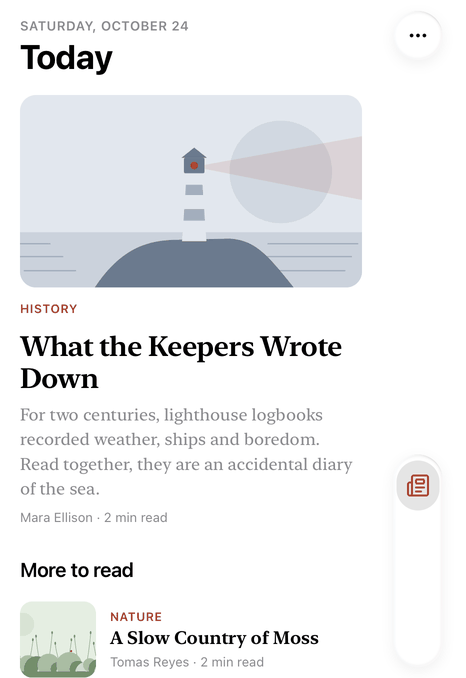
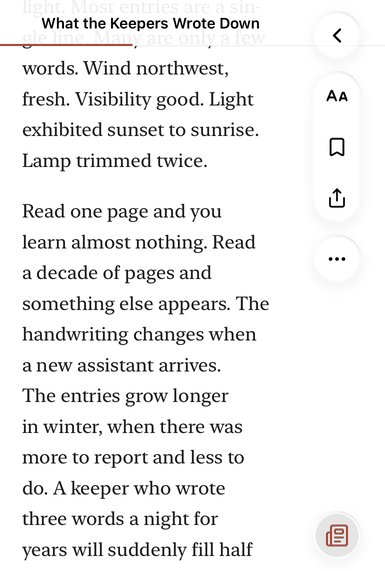

# Almanac

A calm long-form reading app built on Duet. Five original stories sit under Today, Library and Saved tabs plus a search tab. Opening a story shows a full-bleed illustrated hero, a serif text column held to about 65 characters, and a compact title bar with a reading progress line that fades in once the headline scrolls away. It uses Apple system grays in light and dark with a single ink-red accent, and it installs to the Home Screen as a standalone app.

  

## Duet features used

- `<Duet>` with `back`, `actions` (text size, bookmark, share) and `tabs` (three items plus `tabs.search`)
- `tint` on every tab, set to `var(--accent)` so it follows the theme
- `minimizeOnScroll`, so the tab pill collapses while reading
- `bleed(false)` for the edge-to-edge hero and `bleed(16)` for the sticky title bar, so its glass runs under the controls while the title stays beside them
- `--duet-inset-top` and `--duet-inset-left/right` for page padding and the toast position
- The `.duet-scroller` inner scroller for per-view scroll reset, list position restore on back, and reading progress
- Light and dark that follow the system, or GlassyUI's `[data-lg-theme]` when set
- Home Screen setup: `appleWebApp` metadata, `viewportFit: "cover"`, per-scheme `themeColor`, a web manifest and icons

## Run it

From the repo root:

```sh
pnpm install
pnpm --filter @duet/example-almanac dev
```

Then open http://localhost:3101. Bookmarks are kept in localStorage, and a `#slug` link (what Share sends) opens that story directly.
