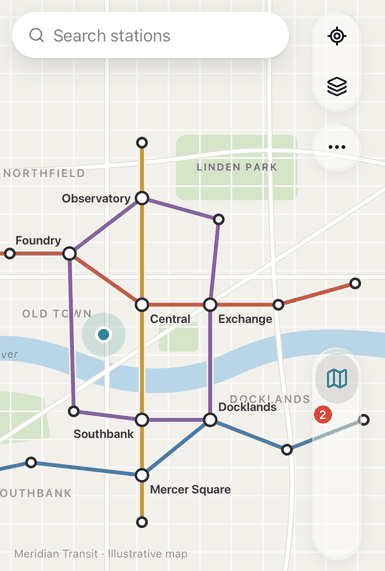
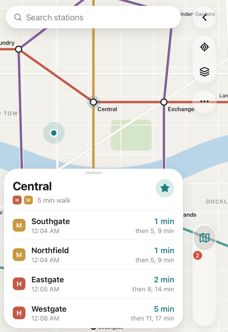
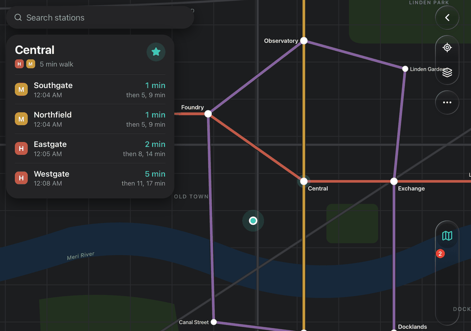

# Meridian

A quiet transit map for a fictional city, built with Duet on Vite and React (no Next.js). A hand-drawn SVG map with streets, a river, parks and four transit lines fills the screen edge to edge and runs under the controls. Drag to pan, pinch or scroll to zoom, and tap a station for a card of upcoming departures computed from the current time. The Lines tab lists line status and service alerts, Saved keeps starred stations, and Search finds stations and lines. It follows the system light or dark appearance with one teal accent, and it installs to the Home Screen as a standalone app.

  

## Duet features used

- `<Duet>` with `tabs` (Map, Lines, Saved plus `tabs.search`) and a `badge` on Lines for the alert count
- `tint` on every tab, set to `var(--accent)` so the accent follows the theme
- `leading` items on the Map tab: Locate me and Layers (transit or explore map)
- `back` that closes the open station, or clears a line focused from the Lines tab
- `bleed(false)` so the map runs under the controls, while drags pan the map instead of scrolling
- `--duet-inset-left/right/top` plus the safe areas to keep the search bar, station card, toast and attribution beside the controls, and to centre the map in the visible area
- Works in Vite with no setup: the `"use client"` directive and the CSS imports inside `duet-ui` need no plugin or config
- Home Screen setup: `apple-mobile-web-app-capable`, `viewport-fit=cover`, per-scheme `theme-color`, a web manifest and icons

## Run it

From the repo root:

```sh
pnpm install
pnpm --filter @duet/example-meridian dev
```

Then open http://localhost:3102. Saved stations are kept in localStorage.
